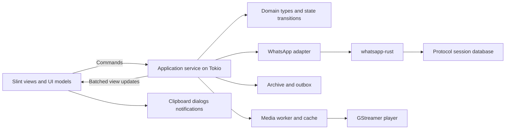

# Heya architecture

Use a Rust application with a Slint presentation layer, a Tokio service runtime,
and an adapter around whatsapp-rust. This document distinguishes the initial
implementation from the wider proposed design.
The selected dependencies and source evidence are in the [upstream audit](upstream-audit.md).

ZapFast supplies the visual reference and may inform interaction ideas. Heya's modules, data model,
storage and playback services are developed independently. The default is to
consume whatsapp-rust unchanged; solve application differences in the adapter
using public APIs. Targeted library changes are authorized when needed. Document
the concrete missing capability, keep the patch isolated and pin the resulting
revision; avoid redesigning Heya around a workaround for a missing public API.

## Module boundaries

The current single crate keeps the offline demo in `domain.rs`, `service.rs`
and `presentation.rs`. Live connection state is application-owned in
`connection.rs`. `protocol.rs` owns the SDK lifecycle and keyed protocol pool;
`protocol_messages.rs` owns SDK ingestion, history decoding and receipt mapping;
`protocol_business.rs` extracts readable business-template content using the same
rules for live messages, history and saved-envelope repair. `archive_repair.rs`
updates eligible unsupported text in bounded startup transactions, preserving
message identity, read state and edits/deletions. The decoder stays in the adapter;
the archive handles opaque envelope bytes. A completion revision avoids repeated
startup scans. Business actions currently render as selectable text.
`protocol_outbox.rs` owns serial delivery through the SDK. `protocol_sync.rs`
handles phonebook/read-state events and recovery of their application mirrors. `storage.rs` owns
private files and keyring access. `archive.rs` and
`archive_schema.sql` own the encrypted application database, while `messaging.rs`
serializes UI commands and produces archive-backed snapshots. Slint types stay
in the presentation modules and `ui/`. No SDK fork or ZapFast application code
is used.

The protocol actor resumes an existing account on normal startup unless automatic
connection is disabled in preferences. With that setting off, it waits for Connect
without touching the keyring or archive. A first launch also waits for Connect
before creating files or keys. `--offline` explicitly opens an existing archive
regardless of the preference; it needs the keyring but starts no network or outbox.
Startup retries typed temporary key-store availability failures after 2, 4, 8,
16 and then 30 seconds, using the existing lifecycle task and finite blocking
attempts. Disconnect or window close cancels its sleep; refused unlock prompts
and missing/invalid keys remain terminal. The UI shows the waiting phase without
blocking other controls. Lifecycle events update a latest-value watch channel inline. Message durability hooks commit supported
batches before returning; history capture persists compressed chunks separately.
Receipt and recovery events use a bounded synchronous handoff; overflow stops
the connection with an error instead of silently dropping events. SDK recovery
paths outside the hook do not provide the same pre-acknowledgment guarantee.
QR encoding, keyring, archive I/O and history decoding stay off Slint's event loop.
Each connection owns its event channels and workers. Terminal failures survive
trailing disconnect events; neither raw SDK errors nor private content is logged.

Local storage is chosen on first run, with encryption selected by default.
Existing profiles retain encryption. The System settings switch saves and
restarts Heya before converting; no active database is converted underneath a
worker. Both databases are exported and verified under the existing profile
lock, then one atomically replaced manifest selects their new location and mode.
Startup cleans incomplete/obsolete conversions before opening the active files.
Plaintext mode uses ordinary SQLite and bypasses the key store entirely. See
[local storage](local-storage.md) for failure, recovery and validation details.

In encrypted mode, the session key is 32 random bytes stored and read back through the OS keyring
before the database is created. A missing key for an existing file is an error.
Every SDK pool connection applies the raw SQLCipher key, checks SQLCipher is
present and verifies the schema before migrations/pragmas. Writes use FULL
synchronous mode. A process lock is held by the pool's connection-init closure,
so detached work also retains it. Shutdown checks the SDK flush report and
separately waits for backend ownership release; an incomplete shutdown disables
retry until the process is restarted. The UI remains responsive while closing
the connection. Application exit allows 20 seconds before interrupting cleanup.
The audio-source watch value also owns a protocol client, even with no remaining
receivers. Clear it before the ownership fence; a scope-exit guard alone creates
a cycle between connection cleanup and client release. Closing the window drains
queued draft/settings writes and exits the process; there is no tray lifecycle.

The session directory lock explicitly unlocks when its owner is dropped. A
helper's briefly inherited file descriptor can no longer keep a normally closed
profile busy. Session connections still retain the owner until their work ends;
mode conversion uses the same guard. A deterministic Unix test holds an inherited
descriptor in a live child while checking release and reacquisition.

Unlink and relink require an explicit confirmation in the UI. Unlink calls the
SDK's remote logout API and distinguishes confirmed removal from an uncertain
result. Revocation is persisted in archive metadata to avoid repeatedly trying
rejected credentials after restart. Relink uses the public transactional
`SqliteDatabase::reset_device` API only after the old SDK store-release fence
has completed. It leaves archive content, keys and phone identity intact; pairing
a different account is rejected before ingestion. No session files are deleted
to recover from an error.

The archive uses a separate random key (`archive-v1`) and schema version 4.
Tables currently cover account identity, chats/drafts, original routing IDs,
aliases/chat redirects, messages/outbox states, mutation tombstones and history
chunks. There is one dedicated account file; its bound phone identity is checked
before ingestion. SQLCipher WAL uses FULL synchronization. Archive ownership also
retains the account file lock after Disconnect so cached chats remain usable.

Schema 2 adds a contact table without rewriting messages or drafts. Saved names
from `ContactUpdate`/`ContactRemoved` are separate from profile names; saved
names override chat-history titles and group sender labels. Explicit removal
suppresses stale history titles. PN/LID merges include contact data, and sender
labels resolve on query so a rename also updates already archived messages.
Profile names alone do not create conversations.

The archive's bound account identity distinguishes self-chat from other contacts.
Its current profile name is persisted in account metadata, independently of the
phonebook entry and historical push names. Self-chat uses `Profile name (You)`
or `You` when unnamed. Profile-sync events update this metadata even without an
incoming message; unchanged values do not invalidate the UI. Sidebar, header and
name search consume the same resolved title, including after an offline reopen.

Schema 4 adds per-message incoming unread/seen evidence, durable per-chat read
positions, pending own-device receipt IDs, history totals and a separate manual
mark-unread flag. Read-self receipts use the referenced message position, including
local ordering within one second; the receipt's wall-clock time never clears a
newer message. Unknown IDs wait for ingestion. App-state read ranges are inclusive
message-time bounds. History totals affect their covered range and cannot undo
explicit read evidence. A history count may include bodies WhatsApp has not sent.
Reads are merged with PN/LID aliases and do not alter outgoing delivery status.
Read-only metadata does not create visible sidebar chats. The previous schema's
counts are retained at migration until synchronized state repairs them.

The existing app-state worker now coalesces read updates as well as contacts.
A first upgrade or unclean session requests `RegularLow` and `CriticalUnblockLow`
snapshots through the unchanged SDK. Failed/incomplete recovery retains saved
state and retries; missing ranges are not replaced with receipt timestamps.
Clean checkpoints follow archive writes and the SDK shutdown fence; queued or
failed receipt work leaves read recovery dirty. Opening a chat still marks it read
locally; outgoing read receipts and sending read-state changes remain pending.

Schema 3 adds account-scoped avatar thumbnails. `protocol_avatars` uses the
unchanged SDK's `pictures().lookup` API, including conditional picture IDs and
explicit absent/private outcomes. Preview lookup can fall back to full size
when absent; the account's LID is also tried after absent PN results. Privacy
denials do not trigger an alternate route. HTTPS downloads accept only WhatsApp/
Meta image CDN hosts, have an eight-second timeout and a 2 MiB body limit, and
do not follow redirects. JPEG/PNG decoding has dimension/allocation limits and
produces one centrally cropped 128×128 RGBA thumbnail on a blocking worker.
Only those pixels and cache metadata enter SQLCipher; source URLs and originals
are not persisted. This does not implement message attachment downloading.

Avatar demand is the viewport (up to 64 rows), selected chat and account, passed
through a latest-value channel. One fetch runs at a time, with a global download
permit retained until a cancelled blocking read exits. The protocol supervisor
cancels/joins its avatar worker before waiting for the SDK store-release fence.
Positive and absent results are reused for a day; transient errors retain cached
pixels and wait five minutes, while server rate limits suspend the whole queue.
`PictureUpdate` clears pixels and advances a generation; guarded writes reject
late results after removal or PN/LID merge. Older notifications cannot overwrite
newer cached notification timestamps.

A separate offline presenter coalesces archive bursts, loads pixels only when
their generation changes, and retains only the demanded thumbnails. Avatar
updates have their own watch channel, so they do not rebuild message views.
Slint images remain confined to presentation; unchanged buffers retain identity,
and chat rows receive targeted notifications keyed by chat ID. The shared Avatar
component clips pictures to its existing circular geometry. No cache tuning UI
or renderer changes are introduced.

The inline app-state handler folds contact/read bursts by JID and mutation timestamp in a
bounded mailbox (100,000 identities / 32 MiB of name text). Database batches run
on blocking workers; no contact callback performs I/O or posts individual UI
jobs. Before starting the SDK, the archive records dirty contact/read mirrors.
Only a successful SDK shutdown, app-state drain and store-release fence clear
those marks. A missing mark, crash or relink requests snapshots of
`critical_unblock_low` and `regular_low` through the pinned public resync API. Incremental sync
alone cannot recover events an older Heya ignored. The snapshot replaces saved
names atomically after a complete report; failed requests retain cached names,
retryable results wait at least 30 seconds, and fatal results wait for reconnect.
The SDK has no atomic application-contact durability hook, so this recovery
mark bridges the independently committed SDK cursor and archive writes.

Outgoing text and its stable protocol ID commit before network I/O; the composer
clears only after that commit. The serialized messaging actor submits the full
composer text and atomically clears its stored draft with the outbox insert,
including when an earlier edit notification could not be queued. Consecutive
queued edits for the same chat collapse to the latest draft; sends, navigation
and edits for other chats remain ordering barriers. Subsequent
edits are separate commands and remain saved. Navigation saves the previous
draft before changing the selected chat; a failed write retains the visible
chat and in-memory draft. Claiming a queued row first persists `sending`.
Restart/disconnect converts interrupted sends to `uncertain`, never back to
`queued`. Server acknowledgments, recipient receipts and own-device echoes
reconcile monotonically. PN/LID merges preserve tombstones, delivery evidence,
drafts and redirected UI selections. A successful socket submission stays
`sending` while the existing ACK/receipt path records its result, within the
same 45-second send deadline. It does not briefly become `uncertain` just because
the ACK event has not been processed yet. Network errors, timeout and interrupted
attempts remain uncertain and never automatically resend. A rejected durability hook both returns an
error to suppress the SDK acknowledgment and notifies the connection supervisor.

`HEYA_TRACE_SEND=1` enables content-free local request/stage timings from command
acceptance through save, composer acknowledgement and view application. For a
synthetic offscreen check including 200 queued edits, short text and 8/32/64 KiB messages,
run this with an optimized build:

```sh
HEYA_BENCHMARK_ARCHIVE=1 HEYA_BENCHMARK_LONG_DRAFT=1 HEYA_BENCHMARK_TYPING=1 scripts/ui-offscreen.sh --ui-benchmark
```

This measures local archive/presentation latency, not live network delivery.
For durability measurements, set `TMPDIR` to a disposable directory on the data
filesystem; `/tmp` may be RAM-backed and hide disk commit costs.

History staging accepts up to 16 MiB per compressed chunk and 256 MiB in total,
with a 64 MiB decompression limit. Import commits 100-message batches and
checkpoints complete conversations; replay of a partial conversation is
idempotent. Completed chunk data is discarded, while failed chunks retain their
bytes and a visible recovery notice. Expiration clears materialized message/edit
content on ingestion, queries and a 30-second refresh; encrypted failed staging
chunks may retain raw historical data until a recovery/removal flow is added.

The implemented UI searches displayed chat titles and loads pages of 100 saved
messages. Sidebar queries bound preview text before it crosses to the UI; full
message bodies and drafts are preserved separately. Immutable sidebar slices
are shared through snapshots. The retained Slint sidebar model compares source
rows, creates toolkit strings on demand and invalidates only changed rows when
length is stable. Each live snapshot stream has at most one pending UI callback;
it reads the latest snapshot and releases the watch-channel lock before applying
it. This coalesces presentation only, after protocol/archive durability work.
Conversation snapshots share immutable message slices, reusing them when the
worker detects unchanged content. The timeline keeps a cached height index and
materializes only nearby rows in a Slint ScrollView. Measurements use the same
component as displayed messages. A message identity and within-row offset anchor
the view during insertions, removals and reflow; bottom following is explicit.
There are no delayed scroll-restoration timers. Clipboard transcript text is
materialized into Slint only when requested. Basic sender protocol edits
and revokes are supported, not every wire variant. Media, full message search,
read-receipt policy, live chat-settings synchronization, full replay recovery UI
and account removal remain proposals below. The owner has reached the connected
chat list, resumed the saved session and confirmed live receiving; outgoing
delivery and recovery validation remain open.

Begin with one application crate and these modules. Split crates only where a
real reuse or build boundary justifies it; the diagram describes ownership,
not a requirement for a large workspace.



| Proposed path | Owns | Must not own |
| --- | --- | --- |
| `src/main.rs`, `src/app/` | Startup, runtime lifetime, command routing and shutdown | Widget rendering or protocol internals |
| `src/domain/` | Account/chat/message IDs, content, drafts, delivery and selection state | Slint, egui or protobuf types |
| `src/protocol/` | Pairing, events, message mapping, media transfer, reconnect | Slint models or archive schema migrations |
| `src/storage/` | Archive migrations, search, ingestion, outbox and drafts | Upstream session schema changes |
| `src/media/` | Download/decode limits, cache, thumbnails and playback service | Unbounded decoded frames or UI ownership |
| `src/platform/` | Clipboard, dialogs, keyring, notifications and desktop lifecycle | WhatsApp behavior |
| `src/presentation/`, `ui/` | Slint models, view mapping, focus and `.slint` components | Blocking I/O or source-of-truth message state |

## Runtime and UI updates

The reusable [state-flow skill](../skills/heya-state-flow/SKILL.md) guides reviews
of callbacks and their workers. Connection, messaging, navigation, chat/message
actions, attachments, clipboard, settings and media retain their existing
controllers; there is no additional shared dispatcher. Presentation owns input
and pending feedback, while workers own capabilities and completed operations.
Media controls reserve command capacity before stopping another player or
clearing call cancellation. A rejected command reports its failure and leaves
the existing activity alone. Send rejection still acknowledges the request if
the archive becomes unavailable before processing; it cannot leave the composer
waiting indefinitely. Regression checks exercise these failures alongside the
existing delayed-save, stale-navigation, progress/model-reuse and cleanup tests.

Run Slint on the main thread. An owned Tokio runtime manages connection and
application tasks. Use dedicated blocking work for SQLite operations and image
decoding; playback follows GStreamer's threading rules. Never run `block_on`, a
database transaction, or a decoder inside a UI callback.

Commands carry stable IDs and a request ID, for example `SendText`, `LoadOlder`,
`StageAttachments`, `Search`, `DownloadMedia` and `SetPlayback`. They must capture
the account/chat at the time of the action. Commands referring to a selection
carry message keys, never list indices.

Persist important events before notifying the UI. Use bounded channels and
coalesce typing/progress/view invalidations; persistent messages must not be
discarded because a UI queue is full. Have the UI reload an affected range from
storage if it falls behind. Use generation tokens to reject stale search,
download or account results. Deliver changes with a weak Slint handle and mutate
`ModelRc`/`VecModel` only on the event-loop thread. Apply row changes in batches;
do not rebuild the entire conversation for every receipt.

The SDK's default async event adapter buffers 256 events, runs up to 16 callbacks
concurrently and drops new events on overflow. Its ordered mode also drops on
overflow. Neither is a durable ingestion queue. Use the message/history hooks
below for persistence, monitor delivery counters, and make UI refresh recoverable
from Heya's archive. Evaluate raw synchronous handlers for lightweight handoff of
critical event-only state such as receipts and chat mutations; they must not do
blocking I/O. Recovery or durable capture of those events is an explicit M2
validation item, not something a larger callback queue guarantees.

On quit, stop accepting sends, flush durable operations, cancel downloads, set
the media pipeline to NULL, and shut down the bot/runtime within a bounded
deadline. History-capture writes need their own cancellation tracking because
upstream shutdown does not join every detached history task.

## Protocol and persistence

Keep upstream authentication, Signal state, transport and wire protocol inside
whatsapp-rust. Use its public typed API rather than reimplementing crypto or
copying protocol internals. Start with one account but scope all application
records and caches by account from the beginning.

Maintain separate files for upstream session state and Heya's archive. Heya owns
only the archive schema. Recommended tables are `chats`, `contacts`,
`identity_aliases`, `messages`, `reactions`, `receipts`, `media`, `drafts`,
`outbox`, `history_chunks` and `schema_migrations`, with an FTS index over
searchable message content. Verify FTS support in the chosen SQLCipher build.

The inbound identity starts with `(account, chat, sender, message_id)`; message
IDs alone are not globally unique. Resolve PN/LID aliases explicitly while
retaining the original protocol identity for receipts and deduplication. Preserve
source order where available and a stable local tie-breaker for equal timestamps.
Pagination must use the same ordering as rendering.

Register the SDK's inbound durability hook to commit each supported incoming
batch transactionally before acknowledgment, then let normal events trigger UI
refresh. The hook must be idempotent and must not synchronously send a reply.
Register history capture separately, durably store each compressed chunk by ID,
then import it in bounded batches with replay checkpoints. Enforce decompression
and disk limits and discard imported staging data according to retention rules.
Record channels/PDO recovery paths that bypass the hook; do not claim exactly-once
delivery or guaranteed recovery when disk writes fail.

An outgoing message first receives a local operation ID and an outbox record.
Keep states for queued, sending, accepted, delivered, read, failed and uncertain.
Persist a protocol message ID before sending and supply it through
`SendOptions::with_message_id`; the pinned API supports reusing that ID on a retry.
Reconcile local echoes with protocol IDs. ID reuse alone does not establish
exactly-once delivery. After an ambiguous network timeout reconcile first, or
require an explicit user retry that explains uncertainty. Preserve
attachment order within a send batch. Server acknowledgment is not a read receipt.

Edits, reactions, deletes and history replay merge idempotently. Retain tombstones
where needed so old history cannot resurrect deleted content. Apply disappearing
message timers to the archive, search and cache. Treat unsupported view-once
content as a placeholder until its lifecycle is correctly implemented. Emit read
receipts from visibility/focus and the user's privacy policy, not merely because
a background download or history import succeeded.

## Local data protection

Recommended baseline: SQLCipher for both databases, with random account keys in
the OS credential store. The protocol store's connection-init hook must key and
verify every pooled connection before migrations. Align `rusqlite` and the
protocol's Diesel dependency on one `libsqlite3-sys`/SQLCipher implementation.
Verify `PRAGMA cipher_version` and rejection of a wrong key in the storage spike.

If the keyring is locked or unavailable, show an unlock/retry state. Do not
silently replace an encrypted database, generate a new key over existing data,
or fall back to plaintext. Use application-specific data directories and private
permissions. Database encryption does not encrypt media files: initially use a
private bounded cache, identify its at-rest exposure in settings, and clear it
on account removal. Encrypted media cache is a later design decision.

Keep log fields to operation IDs, safe categories and timings. Filter upstream
logs that can contain phone numbers, pairing codes, QR payloads or message data;
do not log raw `Debug` events. Session removal must distinguish local data removal
from successful remote unlinking and explain when remote unlink could not finish.

## Text selection and clipboard

Keep selection state outside recycled list rows: message key plus text anchor
and focus, with explicit conversion between UTF-8 offsets and grapheme boundaries.
Use a small WhatsApp-format parser and an independent plain-text representation
for copying/search. Slint styled text and a read-only text editor are candidates;
verify selection, links and accessibility before choosing the rendering method.
Do not feed untrusted WhatsApp text into arbitrary HTML or assume its syntax
matches Markdown.

Start with Slint's built-in text editing and transfer facilities. Implement a
platform adapter only for the MIME types or behavior the selected backend lacks.
Keep a single owner for a paste operation, make clipboard lifetime explicit,
and avoid competing Wayland data devices. File lists precede image thumbnails.
Read the clipboard on a user paste action and validate size/types before staging.
Normalize dropped local-file URIs without interpreting arbitrary URLs as files.

## System notices

Pin/unpin events use an optional application-owned `Notice` in message content.
The adapter recognizes the SDK's `PinInChatMessage` enum; unknown values remain
unsupported. Content decoder revision 8 repairs saved notices in bounded batches,
preserving identities, raw envelopes, read state and drafts while excluding
deleted, expired and edited content. Actor names resolve from current contacts.
The timeline instantiates either a message bubble or a centered `SystemNotice`;
notices contain only text and a rectangle, with no media or action controls.
Two fixed content probes share the displayed components' geometry; their cached
heights keep measurement independent of lazy delegate creation on type changes.
The archive also rejects reply/reaction/forward operations on notices. There is
no pin-state index or pinned-message header yet. Synthetic notice stress can be
measured with `HEYA_BENCHMARK_NOTICES=1 scripts/ui-offscreen.sh --ui-benchmark`.

## Video and audio

Received audio now uses one worker-owned GStreamer pipeline: a random-access
`appsrc` over verified in-memory bytes, `decodebin`, audio conversion/resampling,
`scaletempo` and the system audio sink. SQLCipher holds the compressed originals.
The UI receives coalesced position/state snapshots, never GStreamer objects or
decoded PCM. Seek/rate changes wait for asynchronous preroll; closing, changing
chats and invalidating messages release playback. Source generations reject stale
results, and archive guards reject late writes after mutation. The SDK transport
shares a bounded authenticated writer with received photos.
The coordinator is an async task on the shared runtime; it reserves no playback
thread at startup or during downloads. Ready audio starts a finite helper process
running the existing platform player. Startup, playing and seek/resume responses
have a ten-second parent deadline; paused players wait without a timer. Pipe
closure exits the helper independently of the device thread, with a bounded
kill/reap fallback. Stop/EOS/failure releases the helper. A completion
channel gates replacements, and generation checks reject late results from the
previous player. Pause waits for control changes without polling. Closing cancels
any download before waiting for playback teardown.

Proposed video extension: GStreamer with `appsink`, with Slint rendering
the latest decoded frame. Its integrated pipeline supplies demuxing, decode,
clock synchronization and audio output. This avoids separately synchronizing
an H.264 decoder and an audio engine, but adds native libraries and codec packaging.

First prove a portable pixel-buffer path. Copy rows using the negotiated format
and stride, retain only the latest frame, cap decoded dimensions and queue at
most one pending UI update. Handle pipeline errors and end-of-stream without
closing the application. Use pipeline state/events as the source of playback
status. Stop or release inactive players and media resources when switching
accounts. Measure before investing in EGL texture sharing or hardware decoding.

Use the same playback service for voice notes and video where practical. Test
Opus audio explicitly. Keep media optional during headless/domain builds. On
Windows/macOS evaluate a bundled GStreamer runtime against native-player
adapters under the same interface; Linux success does not establish portable
packaging or codec availability. Track the actual codec-plugin licenses shipped.

## Decisions still requiring evidence

| Decision | Current proposal | Resolution point |
| --- | --- | --- |
| Slint renderer | Winit + Skia/Vulkan preferred on Linux; OpenGL and software startup fallbacks | Renderer timing recorded in development notes; M0 text, video and DPI checks remain open |
| Rich selection | Domain selection model plus Slint text primitives | M0 cross-message selection demonstration |
| Clipboard integration | Slint first, platform adapter for gaps | M0 Wayland/X11 matrix |
| Media backend | GStreamer on Linux | M0 playback and M3 package tests |
| Storage | SQLCipher archive and keyed protocol store | M0 dependency resolution and M2 persistence tests |
| Dependency licenses | No permissive-only restriction; choose for technical fit | Retain routine notices; not a development gate |

The protocol library is unofficial and may break when the service changes.
Keep the dependency pin, an adapter test suite and a deliberate update process.
Its [upstream notice](https://github.com/oxidezap/whatsapp-rust/blob/0dc38af07632f48f0cf6c66df285f1643fc22b95/README.md)
also notes possible account restrictions; include concise, accurate onboarding
information when a user chooses to link an account.

### Explicit message actions

Message operations use application-owned commands through the existing bounded
service channel. Presentation captures message/chat IDs when the user activates
an action; request IDs reject stale acknowledgements and chat changes dismiss
pickers. No opening/searching/hovering action sends anything. The archive worker
revalidates the source, expiry and destination permissions inside the transaction
that persists the outgoing envelope. Quoted drafts persist per chat; enqueueing
a reply atomically consumes its text and quoted target. Forwarding preserves the
recipient's unrelated draft. Merging distinct drafts clears their ambiguous quote.

The forwarding chooser uses the shared avatar cache, including writable chats
absent from the filtered sidebar. Its viewport replaces transcript-sender demand
while open; closing restores normal demand. Only cached texture lookup runs on
the UI thread. Search preserves selection and pending search text; sending stays
explicit and uses the existing request-matched forwarding command.

The isolated protocol action module uses the pinned SDK's quote/forward helpers
and reaction builder. It strips nested quote context on forwarding and retains
photo/audio CDN references without downloading them on the UI thread. The current
text edit projection is used instead of a stale pre-edit envelope. Schema 8 stores
individual reaction events by chat/target/actor with monotonic replacement/removal;
reactions are hidden outbox envelopes, not separate visible messages. Restart and
ACK handling retain the existing uncertain-delivery policy. Media cache triggers
ignore additions of display-only quote/forward metadata but still invalidate on
actual envelope changes and deletion. A batched startup repair recovers quote,
forward and individual-reaction metadata from existing encrypted envelopes.
