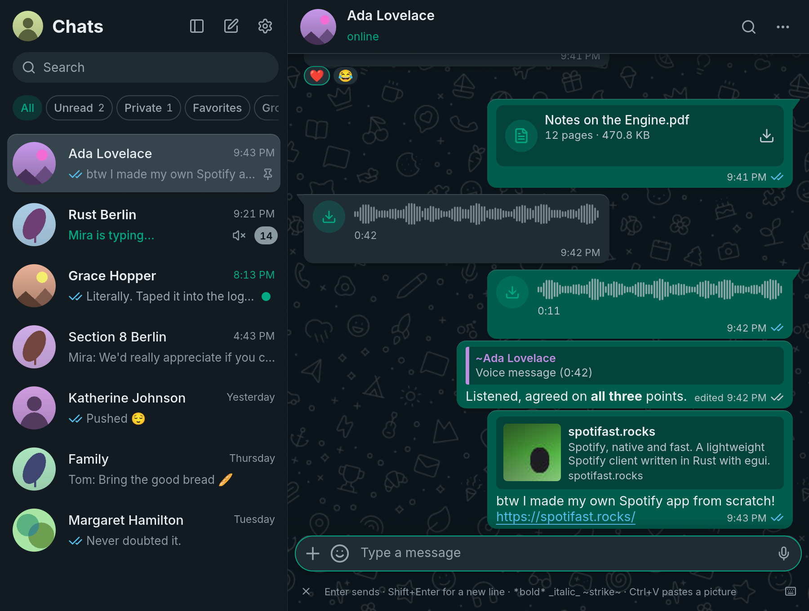
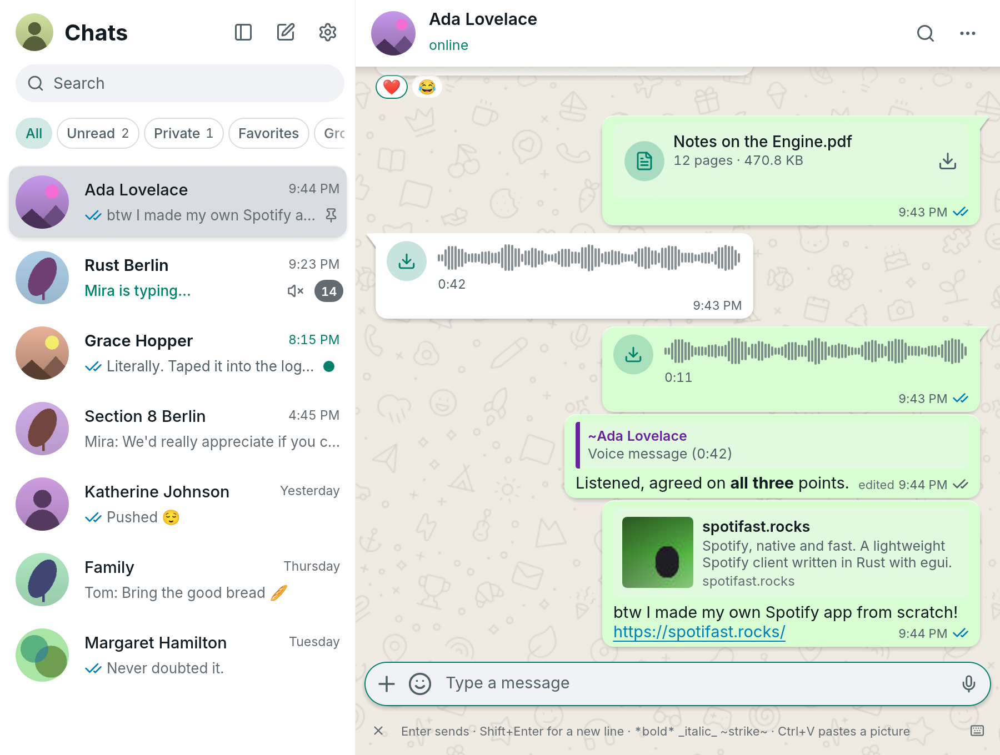

# Heya product and UI specification

Heya takes only ZapFast's look: two-pane layout, density, light/dark colors,
spacing and readable message hierarchy. Implement the UI in Slint with Heya
branding. Design the behavior, keyboard workflow and application logic
independently. Linux ships first; Windows and macOS follow after their integration
checks pass. ZapFast feature parity is not a goal.

## Visual baseline

The supplied images are upstream reference screenshots, not Heya screenshots:

| Dark | Light |
| --- | --- |
|  |  |

See [provenance and notices](../THIRD_PARTY_NOTICES.md). Theme colors are captured
in [zapfast-theme.json](../prep/zapfast-theme.json). They are starting tokens;
contrast must be checked on each actual bubble/background combination.

| Region | Slint component proposal | Heya responsibilities |
| --- | --- | --- |
| Window | `AppWindow`, `Theme` global | Theme, DPI, resize, accessible focus and connection state |
| Left pane | `ChatSidebar`, `ChatRow`, `FilterChips` | Profile, new chat, settings, search, preview, unread count, pin/mute state |
| Header | `ConversationHeader` | Avatar, name, typing/online state, search and chat actions |
| History | `MessageTimeline`, `MessageBubble` | Date separators, unread boundary, sender grouping, quotes, reactions, timestamps and receipts |
| Composition | `Composer`, `ReplyBanner`, `AttachmentTray` | Multiline editing, emoji, attachments, draft restoration and send state |
| Details | `SearchPane`, `ChatDetails` | Search results with jump-to-message; participant and media details |
| Viewers | `ImageViewer`, `VideoViewer`, `AudioPlayer` | Save/copy, zoom, playback, progress, retry and keyboard controls |
| Other states | `PairingView`, `SettingsView`, dialogs | QR expiry, reconnect, session removal, preferences, About and attribution |

Start with a resizable sidebar in the reference's 260–520 logical-pixel range
(macOS title controls may need a higher minimum). At widths where both panes
cannot fit, show one pane with a Back action. Derive the breakpoint from content
minimums. Use logical pixels and test at 100%, 150% and 200% scaling. Proposed
initial demo size: 1200 × 800; include an 800 × 600 layout check.

The implementation dimensions and their upstream declarations are recorded in
[the source audit](ui-source-audit.md). Use these values rather than estimating
sizes from screenshots.

## Release scope

P0 is the first usable Linux release. P1 follows core reliability. P2 is deferred.
All rows describe proposed Heya behavior, chosen independently of ZapFast.

| Area | Heya scope |
| --- | --- |
| Pairing and connection | P0 QR, expiry/retry, resume and visible reconnect; P1 phone code |
| Direct/group chat | P0 text, replies, edits, delete semantics, reactions, receipts, typing and paged history |
| Selection and clipboard | P0 text selection across messages, text/image/file copying and paste, explicit Copy text and Copy transcript, predictable focus and multiline paste |
| Attachments | P0 staged image/video/document sending, caption/reply and cancel/retry; retain per-chat drafts |
| Video | P0 inline/expanded playback, seeking, volume/mute and local cache; evaluate broader codecs with GStreamer |
| Images and voice | P0 image preview and voice playback; P1 recording with permission and discard/send flow |
| Chat organization | P0 local chat/message search, unread and archive/mute; P1 advanced filters, favorites and labels |
| Desktop | P0 light/dark/system, shortcuts, notifications and file dialogs; P1 tray and link activation |
| Advanced messaging | P0 recognizable safe placeholders; P1 display/send support prioritized from real use |
| Accounts and privacy | P0 one account with account-scoped storage; P1 account switching and lock UX after privacy tests |
| Calls, status, channels, communities | P2; optional protocol VoIP capability does not make calling a small media feature |
| Distribution | P0 Linux package; P1 Windows/macOS packages; updater after signed-release design |

Unknown content must show its type and a useful phone fallback, not disappear
or turn into guessed text. Represent loading, empty, offline, pending, failed,
expired and unsupported states explicitly. History availability depends on what
the linked phone provides; search covers the locally stored archive.

## Clipboard and composition acceptance

1. Ctrl+C/X/V/A/Z and redo act on the focused editor. Cmd equivalents apply on
   macOS. Search/dialog fields must not stage attachments into a chat.
2. A single paste is handled once. Prefer a real file list over its thumbnail;
   otherwise paste an image as an attachment or text at the caret. Plain file
   path text remains text unless the clipboard advertises actual files.
3. Pasted images/files enter a preview tray. Nothing is sent until Send. Switching
   chats during asynchronous reads must not change the destination.
4. Enter sends and Shift+Enter inserts a newline by default, with a preference
   for Enter-as-newline and Ctrl+Enter send. IME confirmation and multiline
   paste must never accidentally send.
5. Select words, paragraphs and a range across messages, including while scrolling.
   Copy text preserves Unicode, line breaks and links. Copy transcript adds
   sender/time in chronological order. Selection is independent of row lifetime.
6. Copy image produces image data; Save as chooses a file destination. Reject
   unreadable/missing files clearly and handle spaces and Unicode file names.
7. Test real text, screenshot, file-manager and browser clipboard sources on
   Wayland and X11. Include primary selection separately from the normal
   clipboard and test ownership after focus changes.

Cross-message selection with formatted text is a feasibility gate, not something
assumed to come from stacking `TextEdit` widgets. Check emoji grapheme clusters,
Arabic/Hebrew mixed with Latin, CJK input, and selection through a quoted reply.

## Media acceptance

- A received MP4 with H.264 video and AAC audio plays inside its bubble and in an
  expanded view with synchronized sound. Pausing, seeking and closing work
  repeatedly without frozen UI or a leaked audio stream.
- Space toggles playback, arrows seek, M mutes and Escape exits the viewer when
  the viewer has focus. These shortcuts must not steal typing from the composer.
- A single active audio/video session avoids overlapping sound. Display download,
  buffering, unsupported-codec and corrupt-file states with useful actions.
- Start playback after verified download/decryption. Do not promise progressive
  playback before investigating the protocol's integrity and decryption model.
- Investigate WebM/VP8/VP9/Opus and hardware decode as improvements. Publish only
  formats actually tested in the delivered package; external-player fallback
  is a recovery path, not completion of the in-app player requirement.
- Make automatic-download limits and cache use visible. A manual large-file
  action should check size/free space and remain cancellable; choose the actual
  limit during M3 from Heya's performance and usability requirements.

## Additional improvements worth prioritizing

Preserve scroll position when older history or media dimensions arrive; show a
new-message button while the user reads older content. Keep drafts, reply targets,
and staged attachment metadata per chat, including across restart where the
source file remains available. Show unambiguous pending/failed/uncertain send
states. Provide keyboard access and accessible names for every action, predictable
focus restoration after menus/viewers, scalable text and reduced animation.

Validate the full screenshot set with deterministic offline fixtures before a
live account is involved: pairing, empty list, normal chat, dense group, long
text, search, reply/edit, attachments, viewer, reconnect and errors. Compare the
appearance to the pinned ZapFast reference and behavior to Heya's acceptance
criteria. Pixel-identical rendering across toolkits is not required.
