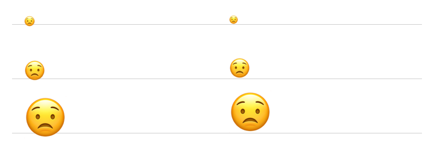

# Apple Color Emoji baseline differs when loaded from font data

Draft; not submitted.

On macOS, `FontMgr::match_family_style("Apple Color Emoji", …)` and
`FontMgr::new_from_data(…, Some(0))` produce different emoji positioning from
the same installed font, glyph ID, requested size and baseline. The data-loaded
glyph sits higher. At small sizes its dimensions and advance also differ.

**Environment:** macOS 15.8.1, x86_64; Rust 1.99.1;
`skia-safe` / `skia-bindings` 0.153.3; Apple Color Emoji.ttc, face 0.

**Reproduce:** [standalone source](macos-emoji-repro/src/main.rs), using only
`skia-safe` and an offscreen raster surface:

```sh
cargo run --manifest-path docs/upstream/macos-emoji-repro/Cargo.toml -- \
  '/System/Library/Fonts/Apple Color Emoji.ttc' /tmp/macos-emoji-repro.png
```

Glyph 2088 (`😟`), bounds relative to the same baseline:

| Font size | Native top / bottom | From-data top / bottom | Native / from-data advance |
| --- | --- | --- | --- |
| 14.5 | -16 / 5 | -16 / 1 | 18 / 14.5 |
| 34.8 | -32 / 6 | -36 / 1 | 35 / 34.8 |
| 69.6 | -62 / 10 | -71 / 1 | 70 / 69.6 |

Native typeface left, data-loaded typeface right; gray lines mark identical baselines:



Should these loading paths produce the same glyph placement? If the difference
is intentional, how should callers position data-loaded Apple emoji consistently
with the native typeface?
